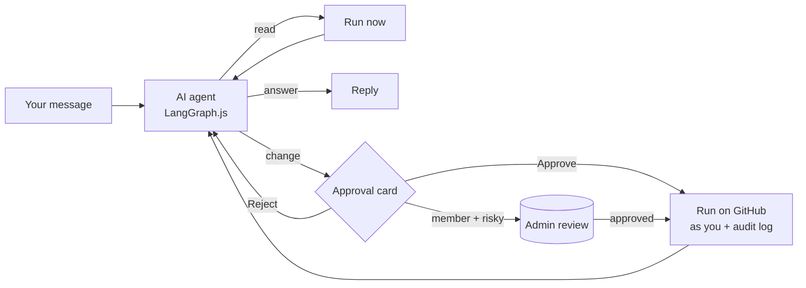

# GitHubOps AI

[](https://github.com/rupeshrrts/githubops-ai/actions/workflows/ci.yml)


**Run GitHub by chat. Approve every change.**

GitHubOps AI is a website where you sign in with GitHub and manage your repositories by typing what you want, in English or Hinglish. An AI assistant does the work. Anything that would **change** your GitHub waits for you to click **Approve**.

> **Live site:** **[githubops-ai.vercel.app](https://githubops-ai.vercel.app)** · **Try it without signing in:** **[githubops-ai.vercel.app/demo](https://githubops-ai.vercel.app/demo)**

| I want to... | Read |
|---|---|
| Know what it does | [What it is](#what-it-is) |
| Try it in 10 seconds, no sign-in | [Demo mode](#demo-mode-no-sign-in) |
| Use it | [How to use it](#how-to-use-it) |
| Run it on my computer | [Run it locally](#run-it-locally-about-15-minutes) |
| Put it online | [Deploy to Vercel](#deploy-to-vercel) · [step-by-step guide](docs/DEPLOYMENT.md) |
| Understand the code | [How it works](#how-it-works) · [code guide](docs/CODE_GUIDE.md) |

---

## What it is

```text
You:  Which of my repos have failing CI?
AI:   2 repositories have failing runs:  octo/api (build) · octo/web (e2e)

You:  Create an issue in octo/api: login button is broken
AI:   ┌ Create issue ─────────────────────────── [Write] ┐
      │ repo: octo/api  ·  title: Login button is broken  │
      │ [ Approve ]  [ Reject ]                           │
      └───────────────────────────────────────────────────┘
You:  (clicks Approve)
AI:   Done. Created issue #42.
```

Why it's safe to let an AI touch GitHub:

- **It can only suggest changes.** Reading is instant. Creating, editing, merging or deleting always shows an approval card first.
- **Everyone acts as themselves.** Each person signs in with their own GitHub account, so the app can only do what they're already allowed to do.
- **Your access stays with you.** The GitHub access you approve is kept encrypted in your own browser. The portal's database never stores it, so it can only be used while you're using the site.
- **Risky actions need an admin.** When a regular member asks to merge, delete or change a repo's visibility, it waits for an admin's approval, then runs from the member's own account.
- **Everything is recorded.** The audit log shows who approved what, and whether it worked.

---

## Demo mode (no sign-in)

Not ready to give an app access to your GitHub? Open **[/demo](https://githubops-ai.vercel.app/demo)** (or click **Try the live demo** on the home page).

- You get a **pretend GitHub account** (`@demo-user`) with 4 sample repositories, issues, pull requests and one failing CI run.
- It's the **real AI and the real approval cards**. Create, delete, open issues, merge pull requests: the panel on the right updates as you approve.
- **Nothing touches real GitHub**, and you don't sign in or authorize anything.
- Each visitor gets their own copy for 24 hours. **Reset demo** starts over.
- **Use my real GitHub** switches to the real thing when you're ready.

The demo allows 30 AI requests per visitor per day (`DEMO_DAILY_LIMIT`) and can be turned off with `DEMO_ENABLED=false`.

---

## How to use it

**1. Sign in.** Click **Sign in with GitHub**, then **Authorize**. That one approval is all the setup a user ever does, and the access it gives stays in their own browser.

**2. Ask.** Type into the chat, for example:

| You type | What happens |
|---|---|
| `List all my repositories` | Answers right away |
| `Which of my repos have failing CI?` | Checks GitHub Actions |
| `mera last commit kya tha?` | Hinglish works too |
| `Create a private repo called demo-app` | Shows a **Create repository** card |
| `Delete demo-app` | Shows a red **Delete repository** card |

**3. Approve or reject.** Every change appears as a card, and nothing reaches GitHub until you click it.

| Card | When | What you see |
|---|---|---|
| 🟡 **Write** | Create or edit something (issue, branch, PR, file, repo) | **Approve** / **Reject**. Some fields are editable. A new repo asks for name and visibility; the description is optional |
| 🔴 **Sensitive** | Merge, delete, or make a repo public/private | **Approve** / **Reject** for admins. Members see **Request admin approval** and the action waits for an admin |

Sending a new message instead of clicking cancels the waiting change.

**4. Other pages** (left sidebar):

| Page | For |
|---|---|
| **Repositories** | All your repos with search. Open one to see CI runs, pull requests and issues, and run workflows |
| **Audit log** | Every change you approved or rejected, and the result |
| **Settings** | Your GitHub connection, role and usage, plus **Reconnect** and **Disconnect GitHub** |
| **Admin** *(admins only)* | Users and their roles, reviewing members' risky actions, everyone's audit log |

### Common questions

- **Do I have to give it access to my GitHub to try it?** No. [Demo mode](#demo-mode-no-sign-in) needs no sign-in.
- **Why does GitHub show the app owner's name on the Authorize screen?** GitHub always shows who registered an app. The access does not go to that person: it is kept encrypted in your own browser, never in the portal's database, and it's only used for your own requests. (To show a team name instead, the owner can transfer the OAuth app to a GitHub organization.)
- **I signed in but see "Connect GitHub".** Click it: one approval. It appears after Disconnect, after signing out, or in a new browser, because the access lives in the browser.
- **Can it change my GitHub without asking?** No. Every change needs your click, and the server enforces that.
- **Who is admin?** The first person to sign in, plus anyone listed in `ADMIN_GITHUB_LOGINS`. Admins can promote others on **Admin → Users**.
- **Can admins read my chats?** No. Chats are private; admins only see the audit log of actions.
- **How do I remove its access?** **Settings → Disconnect GitHub** withdraws it at GitHub and removes it from your browser. Signing out also removes it from the browser.
- **Is there a limit?** 50 AI requests per person per day by default.

---

## Run it locally (about 15 minutes)

You need [Node.js](https://nodejs.org) 20+ and free accounts on **GitHub**, **[Supabase](https://supabase.com)** and **[NVIDIA](https://build.nvidia.com)**.

**1. Install**

```bash
npm install
npm run setup
```

`npm run setup` creates a **`.env.local`** file and fills in three generated secrets. It's your private settings file: never share it or put it on GitHub (it's already git-ignored).

**2. GitHub sign-in:** create an OAuth App at [github.com/settings/applications/new](https://github.com/settings/applications/new):

| Field | Enter |
|---|---|
| Application name | `GitHubOps AI` |
| Homepage URL | `http://localhost:3000` |
| Redirect URI | `http://localhost:3000/api/auth/callback/github` |
| Expire user access tokens | **uncheck** |

Click **Register application**. Copy the **Client ID** into `.env.local` as `AUTH_GITHUB_ID`. Click **Generate a new client secret** and copy it as `AUTH_GITHUB_SECRET`.

**3. Database (Supabase)**
1. Create a project and save its database password.
2. **SQL Editor → New query** → paste all of [`database/setup.sql`](database/setup.sql) → **Run**. You should see *"Success. No rows returned"*.
3. **Connect → Transaction pooler** → copy the link (it ends in `:6543/postgres`), replace `[YOUR-PASSWORD]` with your password, and put it in `.env.local` as `DATABASE_URL`. Don't use the *Session pooler* (port 5432): its 15-connection limit fills up on Vercel.

If your password has special characters, encode them in the link: `@` → `%40`, `#` → `%23`, `/` → `%2F`.

**4. AI key:** at [build.nvidia.com](https://build.nvidia.com), click **Get API Key** and put it in `.env.local` as `NVIDIA_API_KEY`.

**5. Start**

```bash
npm run setup
npm run dev
```

1. Open http://localhost:3000/api/health. It should say `"ok": true`.
2. Open http://localhost:3000 and **Sign in with GitHub**. You're the admin.

---

## Deploy to Vercel

Short version (the full guide, with every step and common fixes, is [docs/DEPLOYMENT.md](docs/DEPLOYMENT.md)):

1. Push the project to GitHub (`.env.local` stays out automatically).
2. On [vercel.com](https://vercel.com): **Add New → Project** → import the repo.
3. Add the 8 settings from your `.env.local` as **Environment Variables**: `DATABASE_URL`, `AUTH_SECRET`, `TOKEN_ENCRYPTION_KEY`, `CRON_SECRET`, `AUTH_GITHUB_ID`, `AUTH_GITHUB_SECRET`, `NVIDIA_API_KEY`, `LLM_MODEL`.
4. Click **Deploy**.
5. In your GitHub OAuth App, **Add redirect URI**: `https://<your-project>.vercel.app/api/auth/callback/github`.
6. Check `https://<your-project>.vercel.app/api/health` shows `"ok": true`, then share the link.

After that:
- Every push to `main` redeploys automatically.
- The database updates itself on each deploy.
- Repository lists refresh when each person opens **Repositories** (with their own access).

---

## How it works



The AI agent (built with **LangGraph.js**) loops between *thinking* (the AI model) and *acting* (GitHub tools). Whenever a tool would change GitHub, the agent stops at the approval step and saves its state in the database until someone decides.

### Roles

| | viewer | member | maintainer | admin |
|---|:-:|:-:|:-:|:-:|
| Chat, read GitHub, see own audit log | ✓ | ✓ | ✓ | ✓ |
| Make changes (with approval) | | ✓ | ✓ | ✓ |
| Approve risky actions, see everyone's audit log | | | ✓ | ✓ |
| Manage users and roles | | | | ✓ |

New users are **members**. Admins change roles on **Admin → Users**.

### Built with

| Part | Technology |
|---|---|
| AI agent | LangGraph.js + LangChain tools |
| AI model | `nvidia/nemotron-3.5-lightning-30b-a3b` on NVIDIA (about 1–2 seconds per step) |
| Website | Next.js 16, React 19, Tailwind CSS 4 |
| Sign-in | Auth.js with GitHub |
| GitHub access | Octokit |
| Database | Supabase (Postgres) |
| Hosting | Vercel |
| Tests | Vitest, PGlite, GitHub Actions |

### Folders

```text
githubops-ai/
├── app/               Page addresses and API endpoints (Next.js needs this folder)
│   ├── (frontend)/    /  /demo  /chat  /repos  /audit  /settings  /admin
│   └── api/           /api/chat, /api/demo, /api/conversations, /api/admin, /api/health ...
├── frontend/          What you see: chat, approval cards, sidebar, admin tables, styles
├── backend/           Server logic: sign-in, roles, AI agent, GitHub tools, database queries
│   └── demo/          Demo mode: the pretend GitHub account and per-visitor sessions
├── database/          setup.sql, the whole database in one file
├── docs/              Code guide and Vercel deployment guide
├── scripts/           setup.mjs (the `npm run setup` command)
├── tests/             72 automated tests
├── .env.example       List of all settings (no real values)
└── vercel.json        Vercel's daily clean-up job (old demo sessions)
```

Every code file starts with a one-line comment saying what it does. The [code guide](docs/CODE_GUIDE.md) walks through a request step by step.

---

## Reference

### Settings

| Name | Required | What it is |
|---|:-:|---|
| `DATABASE_URL` | ✓ | Supabase **Transaction pooler** link (port `6543`) |
| `AUTH_GITHUB_ID`, `AUTH_GITHUB_SECRET` | ✓ | From your GitHub OAuth App |
| `NVIDIA_API_KEY` | ✓ | From build.nvidia.com |
| `AUTH_SECRET`, `TOKEN_ENCRYPTION_KEY`, `CRON_SECRET` | ✓ | Generated by `npm run setup`. Never change the first two after launch (changing `TOKEN_ENCRYPTION_KEY` makes everyone click *Connect GitHub* again) |
| `GITHUB_SCOPES` | | GitHub permissions asked for in the sign-in approval, space-separated (default: full access) |
| `LLM_MODEL` | | AI model (default `nvidia/nemotron-3.5-lightning-30b-a3b`) |
| `ADMIN_GITHUB_LOGINS` | | GitHub usernames that are always admin, comma-separated |
| `DEFAULT_ROLE` | | Role for new users (default `member`) |
| `DAILY_MESSAGE_LIMIT` | | AI requests per person per day (default `50`) |
| `DEMO_ENABLED` | | `false` turns off the no-sign-in demo at `/demo` (on by default) |
| `DEMO_DAILY_LIMIT` | | AI requests per demo visitor per day (default `30`) |

### Commands

| Command | Does |
|---|---|
| `npm run setup` | Creates `.env.local`, generates secrets, checks settings, sets up the database |
| `npm run dev` | Runs the site at http://localhost:3000 |
| `npm test` | Runs the 72 tests (no internet or keys needed) |
| `npm run build` | Builds for production (Vercel runs this for you) |

### Security in short

- Each person's GitHub access is kept **only in their own browser**, encrypted, in a cookie page scripts can't read. The database never stores it.
- Each person's chats and data are **private** to them.
- Supabase's public API is **blocked** from every table (Row Level Security).
- The server **enforces** every approval rule, not just the screen.
- A **daily limit** per person keeps AI costs under control.
- The demo runs on a **made-up account in the database**. It has no GitHub token, so it can't reach real GitHub.

### Troubleshooting

| Problem | Fix |
|---|---|
| Sign-in button is grey, page says *setup required* | A setting is missing. `npm run setup` (or `/api/health`) lists which |
| GitHub: *redirect_uri is not associated with this application* | The OAuth App's Redirect URI must be exactly `http(s)://<site>/api/auth/callback/github` |
| *Sign-in didn't complete* | Click **Sign in with GitHub** again and finish in the same tab within 15 minutes |
| `/api/health` shows `"database":"error"` | Check `DATABASE_URL`: it must be the **Transaction pooler** link ending in `:6543/postgres`, with the password encoded. Port `5432` fails with *max clients reached* |
| Changed a setting in Vercel but nothing changed | Settings only apply after **Deployments → ⋯ → Redeploy**. Secret values can't be viewed later, so paste the full value when editing |
| GitHub actions stop working after a few hours | Uncheck **Expire user access tokens** in the OAuth App, then click **Reconnect** in Settings |
| A banner says *Connect GitHub* | Click it (one approval). The access lives in the browser, so a new browser, sign-out or Disconnect asks again |
| An organization's repos are missing | The organization restricts third-party apps; an org owner must approve the app on GitHub |
